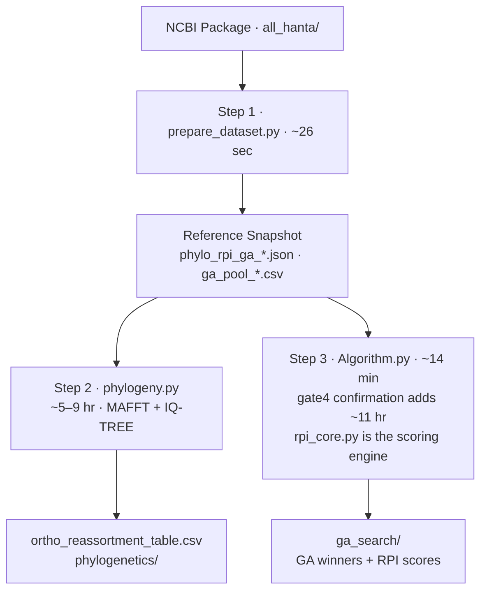

# Orthohantavirus NCBI Dataset Preparation Pipeline

[`prepare_dataset.py`](#step-1--prepare_datasetpy) · [`phylogeny.py`](#step-2--phylogenypy-mafft--iq-tree-reassortment-analysis) · [`rpi_core.py`](#step-3a--rpi_corepy-rpi-scoring-engine) · [`Algorithm.py`](#step-3b--algorithmpy-combinatorial-ga-search)

This pipeline reads an NCBI Datasets **Orthohantavirus** package (`all_hanta/`). Step 1 validates checksums, resolves taxonomy, groups isolates, and writes a reference snapshot. Step 2 builds per-segment phylogenetic trees and detects reassortment. Step 3 scores and searches candidate segment-donor combinations.

---

## Pipeline overview

Step 1 must run first. Steps 2 and 3 are independent of each other. Both read Step 1's snapshot. Run them in either order after Step 1.



| Step | Script | Needs | Produces |
|---|---|---|---|
| 1 | `prepare_dataset.py` | `pandas`, `numpy` | Reference snapshot (`phylo_rpi_ga_*.json`), pool files (`ga_pool_terminal_complete.csv`, `ga_pool_strict_both.csv`, `ga_pools_manifest.json`) |
| 2 | `phylogeny.py` | `mafft`, `iqtree`, Biopython, `dendropy` | `ortho_reassortment_table.csv`, `phylogenetics/<species>/<segment>/`, `phylogenetics_phylogroup/<phylogroup>/<segment>/` |
| 3 | `Algorithm.py` (uses `rpi_core.py`) | Step 1 snapshot; `mafft`, `iqtree` for gate4 | `ga_search/` winners, RPI scores, gate4 confirmations |

---

## Step 0 — Setup

### Step 0-0: Prerequisites

Install these before anything else. Each item is needed at the step marked.

| Item | Needed for | Install |
|---|---|---|
| **Git** | Cloning the repo | <https://git-scm.com/downloads> |
| **Python 3.11 or newer** | All steps | <https://www.python.org/downloads/> — on Linux, use your package manager (`sudo apt install python3.11` or equivalent) |
| **NCBI Datasets CLI** (`datasets`) | Step 0-1 | <https://www.ncbi.nlm.nih.gov/datasets/docs/v2/download-and-install/> |
| **conda / Miniconda** | Step 0-3.1 (Linux only) | <https://docs.conda.io/en/latest/miniconda.html> |

Clone the repository:

```bash
git clone <repo-url>
cd Orthohantavirus
```

### Step 0-1: Download the data

```bash
datasets download virus genome taxon 1980442 \
  --include genome,cds,protein,annotation,biosample \
  --filename all_hanta.zip

unzip all_hanta.zip -d all_hanta
```

### Step 0-2: Stop git from corrupting the package

Do this before anything else. The package ships a file named `md5sum.txt`. This file lists checksums for the exact bytes NCBI published. On Windows, the git setting `core.autocrlf=true` rewrites line endings (LF to CRLF) on checkout for any file git treats as text. This rewrite changes those bytes. A changed byte breaks its checksum. Results then differ between a Linux checkout and a Windows checkout of the same package.

The repo's `.gitattributes` file marks the package as binary, so git does not rewrite it. If your working copy was already changed this way, repair it once:

```bash
rm -f all_hanta/ncbi_dataset/data/* all_hanta/md5sum.txt all_hanta/README.md
git checkout -- all_hanta/
```

The pipeline checks file integrity before it does any other work. You will know immediately if your checkout has a problem.

### Step 0-3: Run the pipeline in order

Run Step 1 first. Steps 2 and 3 are independent. After Step 1 finishes, run Steps 2 and 3 in any order. You can run them in parallel in separate terminals.

| Run order | Step | Script | Extra requirements | Runtime |
|---|---|---|---|---|
| 1 | Step 1 | `prepare_dataset.py` | `pandas`, `numpy` only | ~26 sec |
| 2 | Step 2 | `phylogeny.py` | `mafft`, `iqtree`, ViennaRNA, Biopython, `dendropy` | ~5–9 hr |
| 2 (parallel with Step 2) | Step 3a | `rpi_core.py` | ViennaRNA (for `M_pack` scoring) | minutes |
| 3 (after Step 3a) | Step 3b | `Algorithm.py` | `rpi_core.py`; `mafft` + `iqtree` for gate4 only | ~14 min |

Step 1 uses only `pandas` and `numpy`. All other steps need `mafft`, `iqtree`, or ViennaRNA. How you supply those depends on your platform — see Step 0-3.1 (Linux via conda) and Step 0-3.2 (Windows via pip + `tools/`).

#### Step 0-3.1: Linux

> **Not yet provisioned.** These steps have been verified on Windows only (see Step 0-3.2). The Linux conda environment (`environment.yml`) has never been built on a real Linux machine. In particular, whether bioconda serves `viennarna=2.7.2` is unconfirmed. The steps below are correct in intent; treat them as untested until a green run on Linux is recorded in `tools/VERSIONS.txt`.

Install Miniconda if you do not have conda:

```bash
# Download and install Miniconda (adjust URL for your architecture if needed)
wget https://repo.anaconda.com/miniconda/Miniconda3-latest-Linux-x86_64.sh
bash Miniconda3-latest-Linux-x86_64.sh
# Follow the prompts, then restart your shell or run: source ~/.bashrc
```

```bash
# One-time: create the conda environment (needed for Steps 2, 3a, 3b)
conda config --set channel_priority strict
conda env create -f environment.yml

# ── Step 1 ──────────────────────────────────────────────────────────────────
python3 prepare_dataset.py --input . --output output

# ── Step 2 (run in its own terminal, ~5–9 hr) ────────────────────────────────
conda activate hanta_phylo
python3 phylogeny.py --output output

# ── Step 3a (can start while Step 2 is running) ──────────────────────────────
conda activate hanta_phylo
python3 rpi_core.py

# ── Step 3b (after Step 3a) ──────────────────────────────────────────────────
# Standard run (~14 min, no gate4):
python3 Algorithm.py --reference-input output --output output/ga_search

# With gate4 winner confirmation (~14 min + ~11 hr per pool, needs mafft/iqtree):
python3 Algorithm.py --reference-input output --output output/ga_search --with-phylogeny
```

#### Step 0-3.2: Windows

This machine does not use conda. `mafft` and `iqtree` ship as pinned binaries in `tools/`. All Python packages install via pip. The MAFFT version on Windows is 7.526 (no 7.525 Windows build exists — see `tools/VERSIONS.txt` for the recorded divergence and how the reproducibility fixture handles it).

**One-time setup — Python packages:**

```powershell
pip install -r requirements-pip.txt
```

**One-time setup — `mafft` and `iqtree` binaries:**

The binaries are not committed to git. Download them, verify their SHA-256 checksums, and unpack them into `tools/`. The expected checksums are in `tools/CHECKSUMS.sha256`.

```powershell
# Create the dist directory if it does not exist
New-Item -ItemType Directory -Force tools\dist | Out-Null

# Download the archives
Invoke-WebRequest -Uri "https://mafft.cbrc.jp/alignment/software/mafft-7.526-win64-signed.zip" `
    -OutFile "tools\dist\mafft-7.526-win64-signed.zip"

Invoke-WebRequest -Uri "https://github.com/iqtree/iqtree3/releases/download/v3.1.3/iqtree-3.1.3-Windows.zip" `
    -OutFile "tools\dist\iqtree-3.1.3-Windows.zip"

# Verify SHA-256 checksums — output must match tools/CHECKSUMS.sha256 exactly
(Get-FileHash "tools\dist\mafft-7.526-win64-signed.zip" -Algorithm SHA256).Hash.ToLower()
# Expected: 7c3a508c8512af04007d68019c6fbd4ff00d891244b58f87ec9aa0e53fbae8a7

(Get-FileHash "tools\dist\iqtree-3.1.3-Windows.zip" -Algorithm SHA256).Hash.ToLower()
# Expected: 6e0e11c7ed6197a0f4ebfbadafc7e82bebdf5b6e510c8a13f36183fe8eae3aef

# Unpack into tools/ — each zip extracts to its own named directory
Expand-Archive -Path "tools\dist\mafft-7.526-win64-signed.zip" -DestinationPath "tools" -Force
Expand-Archive -Path "tools\dist\iqtree-3.1.3-Windows.zip"     -DestinationPath "tools" -Force
```

After extraction, verify these paths exist:
- `tools\mafft-win\mafft.bat`
- `tools\iqtree-3.1.3-Windows\bin\iqtree3.exe`

**Run the pipeline:**

```powershell
# ── Step 1 ──────────────────────────────────────────────────────────────────
python prepare_dataset.py --input . --output output

# ── Step 2 (run in its own terminal, ~5–9 hr) ────────────────────────────────
# Pass the tools/ binaries explicitly via --mafft-bin / --iqtree-bin:
python phylogeny.py --output output `
    --mafft-bin tools\mafft-win\mafft.bat `
    --iqtree-bin tools\iqtree-3.1.3-Windows\bin\iqtree3.exe

# ── Step 3a (can start while Step 2 is running) ──────────────────────────────
python rpi_core.py

# ── Step 3b without gate4 (after Step 3a, ~14 min) ──────────────────────────
python Algorithm.py --reference-input output --output output/ga_search

# ── Step 3b with gate4 (~14 min + ~11 hr per pool) ──────────────────────────
# Algorithm.py resolves mafft/iqtree from PATH (no --mafft-bin flag).
# Add the tools/ dirs to PATH for this terminal session first:
$env:PATH = "$(Resolve-Path tools\mafft-win);$(Resolve-Path tools\iqtree-3.1.3-Windows\bin);$env:PATH"
python Algorithm.py --reference-input output --output output/ga_search --with-phylogeny
```

### Step 0-4: Reproducibility model

The pipeline checks file integrity against NCBI's own published checksums. It never checks against digests the script invents itself.

**File level.** The pipeline parses `md5sum.txt` and verifies every file it lists. On a mismatch, the pipeline also tests the CRLF-normalized form of the file to diagnose the cause. It then aborts:

```
CHECKSUM MISMATCH data_report.jsonl
    expected (NCBI): 9c228361ec1892882d118876fcdd263e
    observed (disk): 24dcee9c3c910a59c67093ab818135e7
    diagnosis      : on-disk bytes are CRLF but NCBI published the LF form ...
```

**Content level.** The pipeline uses `nucleotide.sequenceHash` (a CRC32 value NCBI emits per record) for sequence identity and de-duplication. This hash does not depend on line endings or platform, so it gives the same result everywhere. NCBI strips leading zeros from these values — this package's observed widths are 5 to 8 characters — so the pipeline zero-pads them to 8 characters before any comparison. This package has 3,394 exact resubmissions (12,634 distinct hashes over 16,028 records). Without de-duplication, these would inflate group sizes.

The pipeline uses `hashlib` only to hash its own outputs and configuration. Runs are deterministic: two consecutive runs produce byte-identical output.

---

## Step 1 — `prepare_dataset.py`

| Item | Detail |
|---|---|
| **Script** | `prepare_dataset.py` |
| **Reads** | `all_hanta/ncbi_dataset/data/` |
| **Produces** | Reference snapshot (`phylo_rpi_ga_*.json`), pool files (`ga_pool_*.csv`) |
| **Runtime** | ~26 seconds on the 16,028-record package |
| **Python** | 3.11 or newer (uses `datetime.UTC`) |
| **Libraries** | `pandas`, `numpy` — no alignment packages needed |

```bash
python3 prepare_dataset.py --input . --output output
```

| Argument | Default | Purpose |
|---|---|---|
| `--input` | `.` | Package root containing `all_hanta/ncbi_dataset/data` |
| `--output` | `<input>/output` | Output directory |
| `--allow-checksum-mismatch` | off | Pass to continue after a failed integrity check. The pipeline still logs the mismatch. Default: abort. |
| `--cluster-threshold` | `0.02` | Cosine k-mer distance for within-species single-linkage clustering |
| `--verbose` | off | Debug logging |

The transform is GIL-bound and runs serially.

**A fresh checkout does not ship the reference snapshot.** `phylo_rpi_ga_isolates.json`, `phylo_rpi_ga_genomic.json`, `phylo_rpi_ga_cds.json`, and `phylo_rpi_ga_snapshot_manifest.json` are git-ignored. The raw package they come from is also gitignored. A committed snapshot without its source would have misleading provenance. The files regenerate deterministically from `all_hanta/` in ~16 seconds. Run Step 1 before any command that reads `--output` or `--reference-input`. Each raises `FileNotFoundError` naming the missing file if you skip this.

The sections below describe what Step 1 computes and records on every isolate. All results go into the reference snapshot (`phylo_rpi_ga_isolates.json`). Downstream steps read them via `load_reference_data`.

### Taxonomy resolution

The organism-level `virus.taxId` field is **not** usable as a species key. In this package it takes **545 distinct values**. Some values are strain-level taxa, not species (`Hantaan virus Lee` = 11601, `Four Corners hantavirus` = 31621). Some are legacy/current taxid pairs for the same species (`Puumala orthohantavirus` = 1980486 and `Orthohantavirus puumalaense` = 3052493 name the same species under two different IDs).

The `virus.lineage` field has a node immediately below genus *Orthohantavirus* (taxId 1980442). That node **is** the ICTV species [1]. Canonicalizing on this node's binomial name merges legacy/current ID pairs. Doing this on the whole package collapses 545 organism values to **38 species**, plus one `unclassified Orthohantavirus` bucket covering 2,342 records.

The rest of `virus.lineage` supplies every higher taxonomic rank. This gives the full grouping hierarchy:

```
accession → isolate → species → subfamily Mammantavirinae → family Hantaviridae
          → order Elliovirales → class Bunyaviricetes → phylum Negarnaviricota
```

The pipeline keeps records that are unclassified or genus-only. It sets `species_status` on these records. It never merges them silently into a named species.

### Isolate grouping

BioSample is present on only **99 of 16,028** records (0.62%). A BioSample-first grouping cascade would almost never fire. `isolate.name` is present on 15,525 records (96.9%). This is the field submitters use to tie one isolate's S, M, and L segments together.

| Tier | Key | Confidence |
|---|---|---|
| 1 | species + biosample + isolate | 1.00 |
| 2 | species + `isolate.name` | 0.95 |
| 3 | species + normalized isolate/strain label | 0.90 |
| 4 | species + strain + collection date + location | 0.75 |
| 5 | species + strain + location | 0.65 |
| — | accession only | 0.10 |

This grouping produces **1,806 groups with all three of S, M, and L present**, and 223 groups where all three are coding-complete. The data sets the coding-complete ceiling — only 1,339 of 16,028 records are `COMPLETE` at all — not the grouping logic.

### Segment resolution

The `segment` field is dirtier than a simple three-value check assumes. Observed values include `Partial L`, `S segment`, `M-segment`, `M; medium`, `small (S)`, `G1`, `G2`, `ANONYMOUS`, `s`, and `N`. 3,558 records have no `segment` field at all. The pipeline applies evidence in this order:

| `segment_source` | Basis | Confidence | Count |
|---|---|---|---|
| `explicit` | normalized `segment` field (`G1`/`G2` → M, `N` → S) | 1.00 | 12,470 |
| `annotation` | CDS product-name majority vote | 0.90 | 3,115 |
| `defline` | genomic FASTA description | 0.75 | 104 |
| `length_heuristic` | falls in exactly one ICTV size band | 0.40 | 129 |
| `unresolved` | — | 0.00 | 210 |

The `explicit` tier resolves every record that has a `segment` field (16,028 − 3,558 = 12,470, matching the row above). The `annotation`, `defline`, and `length_heuristic` tiers exist to recover records from the 3,558-record no-field group. They recover all but 210.

### Completeness

NCBI's structured `completeness` field is present on 100% of records and is authoritative (PARTIAL: 14,689; COMPLETE: 1,339). The pipeline uses sequence length only to qualify a COMPLETE call as coding-complete. It never uses length to override NCBI's own call. ICTV's published segment sizes are: S 1.2–2.1 kb, M 3.4–3.8 kb, L 6.5–6.6 kb [1]. The pipeline applies the S and M ranges as published. It widens the L range to 6.3–6.8 kb, because submitted L segments in this package sit just outside the published range at both ends — see the note on `SEGMENT_LENGTH_RANGE` in `prepare_dataset.py`.

The pipeline flags a length anomaly only when a sequence contradicts these ranges. A partial sequence is expected to be short. A short partial sequence is not an anomaly. This rule drops the count of length warnings from 5,856 to 9.

### Host classification

The pipeline derives host role from the `host.lineage` rank. It does not use substring matching:

| Observed | Count | Role |
|---|---|---|
| Rodentia | 11,053 | `reservoir_rodent` |
| *Homo sapiens* | 2,109 | `spillover_host_human` |
| Eulipotyphla | 1,035 | `reservoir_shrew_mole` |
| Chiroptera | 83 | `reservoir_bat` |
| `isLabHost` true | 338 | `laboratory_host` |

`isLabHost`, `labHost`, and `isVaccineStrain` are authoritative NCBI fields. The pipeline uses them directly.

**The ML matrix flags lab-derived isolates. It does not filter them out.** `isLabHost` marks the immediate recorded host, not sequence contamination. Of 338 lab-host records (166 isolates), 21 isolates have `host_taxid` 9606 (human). These are lab-acquired or occupational human infections, concentrated in the highest-CFR species (HTNV, ANDV, PUUV, DOBV). Most of the rest are samples from colony-maintained reservoir animals, not culture-adapted sequences. Excluding all of them from a pathogenicity-prediction task would discard real positive evidence of human or reservoir infection. Step 1 records `is_lab_derived` on every `IsolateRecord`. Downstream steps that need this flag read it from the reference snapshot.

**Vaccine strains and lab-derived isolates are excluded from the GA search pools.** A vaccine strain is deliberately attenuated. If its sequence carried its parent species' wild-type pathogenicity label, that would inject a real labeling error. `terminally_complete_isolates` (the pool function) excludes both lab-derived and vaccine-strain isolates. Step 2 (`phylogeny.py`) independently excludes both from all tree builds: passage or attenuation history distorts branch lengths.

**Host jumps.** The pipeline compares each record's host order against its species' expected reservoir order. 33 records are pathogenic viruses recovered outside their reservoir order — SEOV in Chinese shrews and bats, ANDV-clade sequences in Brazilian bats. These are documented host-sharing observations, not data errors. The pipeline records them as `host_jump_status = host_order_mismatch` and weights them in the risk score.

### Pathogenicity labels

`SPECIES_RISK` covers 38 species. Every entry carries its source URL. The pipeline labels a species **absent** from this table as `unknown`. It never silently labels an uncurated species "non-pathogenic".

| Class | Species | Notes |
|---|---|---|
| `pathogenic_hcps` | ANDV, SNV, CHOV, LANV, RIOMV, BAYV, BCCV | Causes hantavirus cardiopulmonary syndrome (HCPS); see [CFR](#case-fatality-rate-cfr) for rates |
| `pathogenic_hfrs` | HTNV, DOBV, SEOV, PUUV | Causes hemorrhagic fever with renal syndrome (HFRS); see [CFR](#case-fatality-rate-cfr) for rates |
| `rare_or_opportunistic` | TULV | Rare, mild human case reports |
| `suspected` | THAIV, SANGV | Not yet confirmed pathogenic |
| `no_known_human_disease` | shrew-, mole- and bat-borne species | See below |
| `unknown` | anything not curated | — |

TULV is held out of `pathogenic_hfrs` deliberately. Lumping its handful of mild case reports with HTNV and DOBV would put 2,123 records in the same class as the species that drive most HFRS deaths.

No shrew-, mole-, or bat-borne orthohantavirus has a confirmed human disease association [2]. Some serological surveys found antibody evidence of past exposure in humans (for example, to the shrew-borne Imjin virus). This is evidence of exposure, not documented illness. These two claims are not equivalent, and this pipeline does not conflate them.

**Curation audit.** Every run checks curated reservoirs against the modal observed host order in the package's own data. An earlier audit found six of the 38 entries disagreed with the package's host annotations at the order level (asikkalaense, fugongense, lankaense, luxiense, sagercreekense, tigrayense). Those six were corrected in `SPECIES_RISK` to match the data. The audit still runs on every invocation. On the current package it reports zero disagreements, so a regression of this kind cannot silently return.

### Case fatality rate (CFR)

**The pipeline does not calculate CFR from any data.** CFR is a **curated literature lookup**: for each of the 38 named species in `SPECIES_RISK` (`prepare_dataset.py`), a person read the published literature and recorded a CFR figure and an ordinal band by hand. A species absent from this table is labelled `unknown`. It is never assumed to be non-pathogenic and never assigned a computed value.

CFR estimates conflict between published sources. The pipeline stores the reported range as text alongside a separate ordinal band used for modelling. Do not collapse the range to one point estimate — a real range is more honest than a false-precision average.

| Species | Reported CFR | Band |
|---|---|---|
| ANDV | approximately 40% [2] | `high_gt_30pct` |
| SNV | 30–50% [2] | `high_gt_30pct` |
| HTNV | conflicting sources: approximately 1% [2], or 5–15% in other reviews — the pipeline stores both figures as text and bands on the higher, more conservative one | `moderate_1_15pct` |
| DOBV | 0–15%, genotype-dependent (Dobrava genotype more severe; Kurkino/Saaremaa genotypes milder) | `moderate_1_15pct` |
| CHOV | 12–15% | `moderate_1_15pct` |
| LANV | 12–15% | `moderate_1_15pct` |
| SEOV | under 1% [2] | `low_lt_1pct` |
| PUUV | 0.1–0.4% [2] | `low_lt_1pct` |
| TULV | under 1%, rare and mostly mild cases [2] | `low_lt_1pct` |
| RIOMV, BAYV, BCCV | human cases documented, but no CFR figure is established in the literature | `unknown` |
| THAIV, SANGV | serological evidence of past human infection only — no confirmed clinical case, so no CFR applies | `unknown` |

**The DOBV, CHOV, and LANV figures above do not carry a `[2]` citation number.** The source code stores them without an individually-verified reference for this project. Treat these three CFR figures as needing independent confirmation before you rely on them.

ANDV is the only orthohantavirus with confirmed person-to-person transmission [2]. Even for ANDV, person-to-person spread accounts for a small share of total cases and needs close, prolonged contact. It is not the typical transmission route [2].

### Species clustering

The pipeline runs within-species single-linkage clustering on cosine distance over 3-mer profiles of the concatenated N+GPC **viral** proteins. The output columns are `kmer_cluster_id` and `kmer_distance_threshold`.

**This is different from host classification.** Host classification (above) identifies the type of animal the virus was collected from — rodent, human, bat — by reading the NCBI host lineage. Species clustering groups virus isolates *within a single viral species* by how similar their own protein sequences are to each other. It has nothing to do with the host. A cluster is a set of viral sequences that are close in sequence space. The hosts of those viruses may be entirely varied.

The ICTV species criterion for Hantaviridae is DEmARC, using a pairwise evolutionary distance (PED) cutoff of **0.1** under the WAG substitution model. This calculation needs a multiple sequence alignment and maximum-likelihood inference [4]. The pipeline's clusters are an alignment-free proxy. They are not PED values (see [Known limitations](#known-limitations)).

### Pool construction

Step 1 writes two pool files from the isolates it has just processed. These are the candidate isolate sets that Step 3 (`Algorithm.py`) searches over:

| Pool | File | Rows | Criterion |
|---|---|---|---|
| Terminally-complete | `ga_pool_terminal_complete.csv` | 314 | All three segments full-length AND carry genuine 5'/3' genomic termini. About 48% of the wild full-length pool lacks both termini (trimmed deposits at NCBI). This is `usable_pool`, and it is what `rpi_core.py`'s own validation/discrimination panel uses. |
| Strict-merged | `ga_pool_strict_both.csv` | 108 | Terminally-complete AND coding-complete (`has_complete_triplet`). Smaller because packaging/reassortment signal lives in the termini that a coding-complete-but-trimmed deposit lacks. |

Both files exclude reserved-calibration isolates at Step 3 load time, not here. The pool files are the unfiltered source of truth. `Algorithm.py` applies the exclusion at runtime.

---

## Step 2 — `phylogeny.py` (MAFFT + IQ-TREE reassortment analysis)

| Item | Detail |
|---|---|
| **Script** | `phylogeny.py` |
| **Reads** | Step 1 reference snapshot (`phylo_rpi_ga_*.json`) |
| **Produces** | `ortho_reassortment_table.csv`, MAFFT + IQ-TREE tree files |
| **Runtime** | ~5–9 hours (default: both scopes, 4 workers) |
| **Install** | `conda env create -f environment.yml` (see environment setup below) |
| **Binaries** | `mafft` 7.525, `iqtree` 3.1.3 (pinned in `environment.yml`) |
| **Libraries** | Biopython, `dendropy` |

```bash
python3 phylogeny.py --output output
```

| Argument | Default | Purpose |
|---|---|---|
| `--output` | `output` | Step 1's output directory — contains the reference snapshot this step reads, and is where it writes its own results |
| `--allow-checksum-mismatch` | off | Accepted for CLI compatibility with Step 1; Step 2 reads Step 1's already-verified reference snapshot and does not re-check `md5sum.txt` itself |
| `--cluster-threshold` | `0.02` | Cosine k-mer distance for within-species single-linkage clustering |
| `--min-species-size` | `8` | Minimum assessable isolates before divergence diagnostics (and `divergence_candidate` tagging) are computed |
| `--verbose` | off | Debug logging |
| `--mafft-bin` | PATH lookup | Path to `mafft` |
| `--iqtree-bin` | PATH lookup | Path to `iqtree` |
| `--phylo-min-taxa` | `4` | Minimum candidate isolates in a species before building segment trees |
| `--bootstrap` | `1000` | IQ-TREE ultrafast bootstrap replicates |
| `--min-bootstrap-support` | `95.0` | Minimum ufboot support to call a topology conflict *supported* |
| `--phylo-seed` | `42` | Fixed IQ-TREE random seed for reproducible trees |
| `--phylo-threads` | cores − 1 | Threads for `mafft` and `iqtree` |
| `--phylo-workers` | `4` | Parallel group workers. Each worker runs one group's mafft+iqtree calls at a time. Total thread demand ≈ `--phylo-workers` × `--phylo-threads`. Reduce `--phylo-threads` manually on machines with fewer cores. |
| `--phylo-scope` | `both` | `species`, `phylogroup`, or `both` — which comparator groupings to analyze |
| `--phylo-outgroup` | none | Accession or isolate to root phylogroup-scope trees on, via IQ-TREE's `-o` |

`--min-species-size` changes Step 2's output: it feeds `compute_segment_divergence`, which sets `divergence_candidate` tagging. Use the same value as Step 1 if you want both output tables to describe the same candidate set. `--cluster-threshold` only feeds `assign_kmer_clusters`. Step 2 computes it to match Step 1's internal state but never reads the result again. Changing it has no effect on Step 2's candidate selection or output.

**Environment setup.** Set up the environment once with the pinned environment file, not an ad hoc `conda create`:

```bash
conda config --set channel_priority strict
conda env create -f environment.yml
```

Channel order matters. The command `-c bioconda -c conda-forge` (bioconda first) resolves Biopython from bioconda's own channel, pulling in a Python 3.6/numpy 1.12 toolchain silently. `environment.yml` lists `conda-forge` first and `bioconda` second (the order bioconda's own documentation recommends). Biopython, pandas, numpy, and pyarrow resolve from conda-forge's current builds. `mafft` and `iqtree` — which exist only in bioconda — still resolve there and are pinned to exact versions (`7.525` and `3.1.3`).

After setup, either run `conda activate hanta_phylo` before running this script, or keep your normal environment active and pass `--mafft-bin`/`--iqtree-bin` pointing at that env's `bin/`. **Do not add that env's `bin/` to the front of `PATH`** without activating it fully — this has been observed to install a Python 3.6 interpreter as `python3`, shadowing the intended one.

**Measured wall-clock** on the 16,028-record package with default settings:

| Scope | Serial | `--phylo-workers 4` | Bottleneck |
|---|---|---|---|
| species | ~201 min | ~98 min | puumalaense (425 taxa, ~98 min alone) |
| phylogroup | ~359 min | ~212 min | arvicolinae_borne (755 taxa, ~212 min alone) |
| **both (default)** | **~560 min (~9.3 hr)** | **~310 min (~5.2 hr)** | |

Workers > 4 buy nothing on this dataset. Species scope has exactly 4 groups that individually exceed 28 min. Phylogroup scope has exactly 4 groups total.

### Candidate selection

Step 2 reads Step 1's snapshot and selects isolates from three groups, unioned together. Each group is independently a reason an isolate matters for the reassortment/pathogenicity goal. The union is then intersected with one hard requirement: CDS must be available for all of S, M, and L, since a topology comparison needs every isolate placed in all three trees.

| Group | Criterion |
|---|---|
| human-affecting-or-likely | `pathogenicity_class` is one of `pathogenic_hcps`, `pathogenic_hfrs`, `rare_or_opportunistic`, `suspected`; or the isolate is from a not-yet-curated species observed directly in a human host (`host_role == spillover_host_human`) |
| divergence candidates | isolates the k-mer diagnostic already flagged `requires_phylogenetic_confirmation` |
| complete triplets | isolates where `has_complete_triplet` is true |

Lab-derived, vaccine-strain, and `unclassified`/genus-only isolates are excluded. The genus-only group is excluded because pooling isolates under a shared placeholder `species_name` would build one tree across genuinely unrelated lineages.

On the current 16,028-record package with default `--phylo-min-taxa 4`, Step 2 identifies **1,470 candidate isolates (species scope)** across 14 analyzable species. 8,082 are excluded before grouping: 6,413 missing CDS for one or more segments, 1,503 unclassified, 166 lab/vaccine.

### Phylogeny analysis

**Per species** (at least `--phylo-min-taxa` isolates, sorted for a deterministic order): the pipeline extracts CDS nucleotide sequences per segment with `select_primary_cds` (role-matched from `cds.fna`; when more than one CDS matches a role, the longest one wins — this correctly prefers a combined G1+G2 precursor CDS over either half alone, when both are annotated). It aligns these with `mafft --auto`, then builds a tree with `iqtree -m MFP -B <bootstrap> --seqtype DNA --seed <fixed>` (model selection combined with ultrafast bootstrap; the DNA type is asserted rather than auto-detected because a heavily-N'd partial CDS can confuse detection). Tip labels are synthetic (`I0000`, `I0001`, …) rather than the real `isolate_key`, to avoid Newick-incompatible characters.

**Per isolate**, from the three real trees: the pipeline computes patristic nearest-neighbour and rank-separation diagnostics. These have the same statistical shape as `sl_rank_separation`/`m_rank_offset` (Step 1's k-mer proxy), but computed from real phylogenetic distance. This is the actual fix for the k-mer classifier's failure mode described in the Reassortment background below. The pipeline calls a candidate `supported_reassortment_candidate` only if two conditions both hold: the rank pattern matches the literature's M-segment-exchange signature (S and L agree; M's neighbour differs) [3], **and** the relevant M-tree clade clears `--min-bootstrap-support` (default 95). Anything below that threshold is `weak_signal_low_bootstrap_support`, not a finding.

**Per species**, the pipeline computes Robinson-Foulds distance (via `dendropy`) between each pair of segment trees on their shared taxon set — an overall measure of how much the three trees disagree.

**Nothing is silently dropped.** Every candidate isolate appears exactly once in `ortho_reassortment_table.csv` with `phylo_status` set to `analyzed`, `failed` (with the specific error recorded), or `species_below_min_taxa`. A species failure never aborts the run.

### Output columns — `ortho_reassortment_table.csv`

One row per candidate isolate per requested scope. Every field is always present, even for a not-yet-analyzed or failed row, so the table keeps one stable, joinable schema — see `_phylo_row`'s docstring.

| Column group | Columns | Notes |
|---|---|---|
| **Identity / selection** | `isolate_key`, `species_name` | `species_name` is the isolate's true species, never the phylogroup label |
| | `candidate_tags` | Why this isolate was selected: `human_affecting_or_likely` / `divergence_candidate` / `complete_triplet` — can be more than one |
| | `analysis_scope` | `species` or `phylogroup` — a candidate can appear once per scope under `--phylo-scope=both` (the default) |
| | `phylogroup_assignment_basis` | `curated_reservoir` or `observed_host_order` — only meaningful at `analysis_scope == phylogroup` |
| **Tree status** | `n_taxa_in_species_tree` | Taxa in this row's tree — imprecise for phylogroup-scope rows on purpose, see the code comment |
| | `phylo_status` | `analyzed` / `failed` / `species_below_min_taxa` |
| | `phylo_error` | Error message if `phylo_status == failed` |
| **Per-isolate tree diagnostics** | `tree_s/m/l_nearest_isolate` | Nearest neighbour in each segment tree |
| | `tree_s/m/l_distance` | Patristic (branch-length) distance to nearest neighbour |
| | `tree_s/m/l_rank_offset` | Rank offset in each segment tree |
| | `tree_sm/sl/ml_rank_separation` | Rank separation between segment pairs |
| | `discordant_segment` | Segment whose nearest neighbour differs from the others |
| | `matches_canonical_m_exchange` | True when S and L agree and M's neighbour differs — the literature's M-exchange signature [3] |
| **Bootstrap gate & call** | `m_clade_bootstrap_support`, `discordant_clade_bootstrap_support` | `None` (not `0.0`) when no discordant clade exists — a real 0% must stay distinguishable from "not applicable" |
| | `bootstrap_support_source` | `mrca` / `nearest_supported_ancestor` / `unsupported_root` — empty for `no_conflict` rows |
| | `reassortment_call` | `not_analyzed` / `no_conflict` / `weak_signal_low_bootstrap_support` / `supported_reassortment_candidate` |
| **Per-tree topology summary** | `species_rf_s_vs_m`, `species_rf_m_vs_l`, `species_rf_s_vs_l` | Robinson-Foulds distance between segment tree pairs (via `dendropy`) |
| | `*_normalized` variants | Normalized RF distances |
| | `s/m/l_alignment_path`, `s/m/l_tree_path` | On-disk locations under `<output>/phylogenetics/<species>/<segment>/` |

---

## Step 3 — RPI scoring and GA search

### Background: reassortment detection — the k-mer classifier and why it was replaced

**By default, this pipeline does not call reassortment.** An earlier version had a k-mer-based classifier that did. The team withdrew it after it failed validation against the literature.

Reassortment frequency varies by species, not by genus. One survey across 553 orthohantavirus genomes and seven species found reassortment absent in ANDV, and frequent in DOBV, SNV, SEOV, PUUV, and TULV [5]. For PUUV specifically, an earlier set of Finnish studies reported frequencies from 19.1% to 32% [3]. The withdrawn classifier produced the inverse ranking, measured on an earlier snapshot of this package (15,991 records):

| Species | n | flagged | literature |
|---|---|---|---|
| ANDV | 68 | 72.1% | absent or sparse [5] |
| CHOV | 8 | 100.0% | not reported |
| DOBV | 62 | 38.7% | frequent [5] |
| PUUV | 416 | 7.7% | frequent, 19.1–32% [3] [5] |
| TULV | 313 | 3.5% | frequent [5] |

These counts are a frozen record of the specific run that revealed the failure mode, not a live measurement. The classifier no longer exists in this codebase. The general point — the ranking is the *inverse* of the literature's — is a property of the metric, not of the record count.

Sweeping the discordance threshold from 0.25 to 0.85 scaled every rate down but never changed the ordering. The cause is intrinsic: cosine distance on 3-mer amino-acid composition tracks within-species sequence diversity and sample size, not tree topology. CHOV, flagged at 100% on only 8 sequences, is the clearest symptom.

The underlying k-mer measurement (`sl_rank_separation`, `m_rank_offset`) is retained as informational signal on every `IsolateRecord` in the reference snapshot. Step 2 (see above) replaces the *call* — a real reassortment verdict — not this underlying measurement.

The reassortment pattern most reported in the literature is M-segment exchange: the M segment moves between lineages more often than S or L, and S and L tend to stay together from the same parent [3]. Reassortment is reported mostly between closely related strains within one species or region (sympatric), and rarely between distantly related species [3].

The one reassortment-adjacent signal in this pipeline that is trustworthy on its own is `taxonomic_incongruence`: one isolate label whose segments NCBI assigned to more than one species (34 isolates in this package). This is a metadata observation, not an inference, and it does feed the risk score. The pipeline computes it across groups, never within a group.

### Step 3a — `rpi_core.py` (RPI scoring engine)

| Item | Detail |
|---|---|
| **Script** | `rpi_core.py` |
| **Reads** | Step 1 reference snapshot; `data/rpi_calibration.json` (built by `calibrate`) |
| **Produces** | RPI scores, calibration artifact, discrimination panel results |
| **Runtime** | Default `run`: minutes; `calibrate --stability`: longer |
| **Libraries** | ViennaRNA Python bindings (for `M_pack` scoring) |

**Purpose.** `rpi_core.py` is the single module and CLI entry point for the Reassortment Plausibility Index (RPI) toolchain. It calibrates `M_pack`'s Boltzmann rescaling against a held-out isolate panel. It scores a four-group discrimination panel (random fakes, within-species shuffles, cross-species sympatric shuffles, and real published/supported reassortants). It runs the `reals ~ b1 > b2 > random` pass criterion (Mann-Whitney U + Cliff's delta). See ["Reassortment Plausibility Index — limitations"](#reassortment-plausibility-index--limitations) for what the index does and does not claim.

**How to run:**

```bash
python rpi_core.py                       # same as `run`: calibrate -> discriminate -> stats -> report
python rpi_core.py run --recalibrate     # force-rebuild data/rpi_calibration.json
python rpi_core.py run --seed 20260829   # override the discrimination panel's seed (default shown)
python rpi_core.py calibrate             # rebuild data/rpi_calibration.json directly
python rpi_core.py calibrate --stability # branch the calibration across seeds x windows
python rpi_core.py validate --json output/validation/validation_report.json
python rpi_core.py score --reference-input output --output output/score --candidate id:s.fasta,m.fasta,l.fasta
python -m unittest rpi_core              # full suite, 334 tests
```

`run` reuses the pinned calibration artifact (`data/rpi_calibration.json`) unless it is missing or `--recalibrate` is passed. A step that raises halts the run there. Each step's input is the previous step's output, so nothing downstream runs on a half-built result.

**Module layout.** `rpi_core.py` is the only file for this toolchain — consolidated from six modules (`reassortment_detector.py`, `rpi_calibration.py`, `rpi_discrimination.py`, `rpi_discrimination_stats.py`, `validate_reassortment_detector.py`, `pipeline.py`); see `docs/PROJECT-STATE.md` (Phase 6) for the record of that consolidation.

**Headline results — from the post-`build_swap`-fix panel only** (seed 20260829, τ = 3.914; see `notes_e_isolate_fix.md` for the full before/after record):

| Comparison | p (two-sided Mann-Whitney U) | Cliff's δ | Met expectation |
|---|---|---|---|
| `b2_cross_species_sympatric` > `a_random_fakes` | 4.68 × 10⁻⁹ | +0.953 (large) | ✅ True |
| `b1_within_species_shuffle` > `b2_cross_species_sympatric` | 2.18 × 10⁻¹¹ | +0.961 (large) | ✅ True |
| `c_real_positive` ~ `b1_within_species_shuffle` | 0.733 (not significant) | +0.078 (negligible) | plausible tie, not proven equivalent |

**`overall_ranking_supported = True`.** Read this alongside the limitations below, not instead of them. The `reals_vs_b1` tie is an absence of evidence for a difference, not proof of equivalence. Two of the index's four generation factors (`M_pack`, `M_pol`) carry real signal for only a minority of candidates (item 8 of the limitations list).

**Known limitations** — the full, binding list is ["Reassortment Plausibility Index — limitations"](#reassortment-plausibility-index--limitations). Do not quote a headline number without it. In brief: the index is relative, not an absolute probability; every in vitro anchor is Vero E6; the constellation prior rests on ~35 total observed reassortants across two studies with confounded MOI; compatibility is directional but the metrics are largely symmetric; no gold-standard label set exists; `M_pack` is a real but small signal (Cliff's δ = +0.222); `M_pol` carries real signal only for an SNV backbone; the K stratum is a protein k-mer proxy marked `rpi_k_stratum_provisional = true` on every row. Gate 1 cannot see intra-species reassortment by construction (a validated blind spot — see ["Reassortment detector — validation"](#reassortment-detector--validation-against-published-reassortants)).

### Reassortment Plausibility Index — limitations

`rpi_core.py` computes a Reassortment Plausibility Index (RPI) — `rpi_generation` and `rpi_retention` — for candidates it scores. This section is deliberately first in the design spec it comes from, and any Methods paragraph describing it must reproduce it. Every number this index produces inherits these constraints:

1. **The index is relative, not an absolute probability.** `rpi_generation = 0.4` does not mean a 40% chance of anything. It means this constellation scores 0.4 on a bounded index whose factors are anchored to published measurements. Ranking is meaningful; the absolute value is not.
2. **Every in vitro anchor is Vero E6** — an African green monkey kidney line, not reservoir rodent cells. Strandin et al. (2020), already in the project library, exists precisely because host-cell context changes hantavirus behaviour. Reassortment frequencies measured in Vero E6 may not transfer to *Myodes*, *Peromyscus* or *Apodemus* cells.
3. **Total observed reassortants across all direct measurements ≈ 35.** Rodriguez et al. (1998) contributed 25 + 1; Rizvanov et al. (2004) contributed 10 monoploid. The constellation prior (§7) rests on this, and no amount of smoothing manufactures statistical power that is not there.
4. **MOI is confounded across studies.** Rizvanov used MOI 3; Rodriguez used MOI 1. Rizvanov names this explicitly as the likely reason their cross-species frequency (8.9%) exceeded Rodriguez's within-species frequency (8.5%). **Cross-study reassortment frequencies are therefore not comparable**, and this spec never compares them. Only Rodriguez's internal contrast (both arms MOI 1, shared NMR11 parent) is controlled.
5. **Compatibility is directional; our metrics are largely symmetric.** McDonald et al. (2016) report that φ13 packages φ6's M segment while φ6 cannot package φ13's M unless φ6 packaging sequences are appended. Sequence- and ΔG-based metrics computed symmetrically will lose this asymmetry. Documented, not solved.
6. **No gold-standard label set exists.** The pipeline's own output contains 8 `supported_reassortment_candidate` calls out of 2,995 rows. Nothing can be fitted to 8 positives. This is the reason the index is literature-anchored rather than learned, and it is also why §11 orders the validation evidence the way it does.
7. **`rpi_retention` models immediate post-reassortment fitness only.** McDonald's Fig. 4 mode (c) — compensatory mutations restoring interaction interfaces after reassortment — is **out of scope** and is a named limitation, not a term in the model. A reassortant scored low may still emerge after adaptation.
8. **Both molecular generation factors are now measured (WS3.1–WS3.4, 2026-08-29), and both are weaker signals than the design hoped.** The design defines `rpi_generation = E × K × M_pack × M_pol`. As shipped:
   - `M_pack` (`score_m_pack`, D3): the candidate's own cross-segment panhandle duplex, cofolded via the ViennaRNA Python bindings and rescaled `M_pack = exp(-ΔΔG / τ)` against the **backbone species' own reference consensus** (never the candidate compared to itself). τ = 3.914 is *derived*, not chosen — the robust p5–p95 span of ΔΔG over a 42-isolate, 14-species, 756-fold calibration panel disjoint from every validation group below (`rpi_core.py calibrate`, `data/rpi_calibration.json`). **The signal is real but small**: only 62% of the calibration panel's observations have non-cognate duplexes weaker than cognate ones in the expected direction, and 38% have ΔΔG ≤ 0, where M_pack saturates at exactly 1.0 and contributes nothing (Cliff's δ = +0.222, conventionally "small"). The genus's terminal 14 nt are invariant across species *and* across S/M/L, which structurally caps what a terminal duplex can distinguish.
   - `M_pol` (`score_m_pol`, D3): the candidate's own N-recognition footprint beyond the invariant tag, compared against the **backbone species' own reference consensus** CDS window (never the candidate compared to itself). `rpi_m_pol_status` reports whatever `polymerase_compatibility` actually returns — `scored` or `no_signal_beyond_tag`. **The signal exists only for one species.** Mir & Panganiban's [8] genus-9-vs-SNV-23 asymmetry is the only wired footprint length (`RPI_N_FOOTPRINT_NT`); every other species defaults to 9 nt, which falls *entirely inside* the invariant 14-nt tag, so `M_pol` reports `no_signal_beyond_tag` (neutral 1.0) for any backbone that is not *Orthohantavirus sinnombreense*. Measured on the WS4 panel: SNV-backbone candidates score 0.74–0.96 (`scored`); the other 9 of 12 candidates report `no_signal_beyond_tag`. **`m_pol_variance_check` (spec 6.2's mandatory gate) is declared but not invoked** — it is a run-level check over a representative sample of lineage pairs, not a per-candidate computation, and wiring that aggregation is future work.

   **`rpi_generation` is the full four-factor product `E × M_pack × M_pol × K`**, but two of those four factors carry real signal for only a minority of candidates. Neither gap is closed by retuning a parameter; both are named limitations of what the underlying biology currently supports measuring.
9. **The K stratum is derived from a proxy, and every row says so.** `identity` is fed from `gate0.best_kmer_identity` — **protein** k-mer novelty against the nearest reference, maximised over segments — not the **parental nucleotide** divergence §7 stratifies on, and it lives on a different scale (~0.35–0.46 observed, against calibration points of 0.548 / 0.707 / 0.85). Every scored row carries `rpi_k_stratum_provisional = true` for this reason. Deriving real parental identity from the reference sequences is a documented follow-up.
10. **`modal_agrees` saturates and must never be quoted alone.** In the retrospective reproduction harness the distant top set is `{M}`, the close top set is `{M, S}`, and every benchmark observation's top set contains M — so no input in this benchmark can return `False`. `composition_distance` (total-variation distance between prior and observed composition) is the **primary** agreement measure; it is quantitative and can fail. A tied prediction (`predicted_modal_segment = null`) is a non-prediction, not a confirmation, and must not be counted as a success.

The sensitivity sweep (`sensitivity_sweep`) and the rank-consistency sanity check (`rank_consistency`) that operationalize these limitations are documented in `docs/PROJECT-STATE.md`.

**Docs map:**

| Document | What it's for |
|---|---|
| `docs/PROJECT-STATE.md` | Single source of truth: project aim, architecture, decisions of record (D1–D14), full progress timeline, current state, binding limitations, repo policy — the one file to read before touching this codebase |
| `data/rpi_calibration.json` | Pinned M_pack calibration artifact — τ = 3.914, the 42-isolate panel it was derived from, and the D1 decision inputs; ships in the repo so the rescaling is independently verifiable |
| `docs/My Library.csv` | Zotero-exported citation library; every numerical claim in this README is checked against it |

Session work-logs, design specs, and task plans (`docs/superpowers/{specs,plans,notes}/`,
`.superpowers/sdd/`) were consolidated into `docs/PROJECT-STATE.md` and deleted on
2026-09-18. Tracked content remains in git history if ever needed; the gitignored SDD
ledgers were local-only and are not recoverable.

### Reassortment detector — validation against published reassortants

`rpi_core.py validate` scores a panel whose ground truth is known independently of the detector, and reports a confusion matrix. Run it with:

```bash
python rpi_core.py validate --json output/validation/validation_report.json
```

**Result (54 candidates, all built from real sequences in `all_hanta/`):**

| Class | n | Result |
|---|---|---|
| Published **inter-species** reassortants | 3 | 3/3 exchanged segment correctly named |
| Synthetic inter-species swaps (S, M and L donated in turn) | 15 | 15/15 correctly named |
| **True negatives** — real unmodified isolates, one per species | 27 | 27/27 silent, **0 false positives** |
| Published **intra-species** reassortants | 5 | 5/5 silent — **measured blind spot, not a pass** |
| Adversarial (random, shuffled, truncated, empty) | 4 | 4/4 handled, none scored as a reassortant |

Sensitivity 18/18 (1.00), specificity 27/27 (1.00).

#### Which published reassortants were tested

These are **reconstructions of published constellations** from the parental sequences in this dataset, not the published reassortant clones themselves. Where the paper's exact parental strain is in the dataset it was used, and the report marks the row `parents_are_exact_published_strains`.

| Source | Cross | Parents used | Detected |
|---|---|---|---|
| **Rizvanov, Khaiboullina & St Jeor (2004)** *Virology* 327:225–232, [doi:10.1016/j.virol.2004.07.012](https://doi.org/10.1016/j.virol.2004.07.012) | SNV S+L × ANDV M | **Exact published strains** — SNV NM R11 (`NC_077669.1`, `NC_077671.1`) × ANDV Chile-9717869 (`NC_003467.2`) | ✅ `m_only`, segment M |
| Rizvanov et al. (2004), reciprocal | ANDV S+L × SNV M | **Exact published strains** — ANDV Chile-9717869 (`NC_003466.1`, `NC_003468.2`) × SNV NM R11 (`NC_077670.1`) | ✅ `m_only`, segment M |
| **Handke, Oelschlegel, Franke, Wiedemann, Krüger & Rang (2010)** *J Gen Virol* 91:2351–2359, [doi:10.1099/vir.0.021139-0](https://doi.org/10.1099/vir.0.021139-0) | PUUV S+L × PHV M | Representative strains — PUUV Saratov-MG120 × PHV `NC_038940.1` | ✅ `m_only`, segment M |
| **Rodriguez, Owens, Peters & Nichol (1998)** *Virology* 242:99–106, [doi:10.1006/viro.1997.8990](https://doi.org/10.1006/viro.1997.8990), Table 7 | SNV NM R11 × CC107, M-exchanged and S-exchanged arms | **Exact published strains** — NM R11 (`NC_077669.1`/`NC_077670.1`/`NC_077671.1`) × CC107/POR (`KT885046.1`/`KT885045.1`/`KT885044.1`) | ⚪ Silent — intra-species blind spot |
| **Klempa (2018)** *Virus Genes* 54:638–646, [doi:10.1007/s11262-018-1590-z](https://doi.org/10.1007/s11262-018-1590-z) | DOBV intra-genotype M; PUUV intra-lineage M | Representative strains | ⚪ Silent — intra-species blind spot |
| **Park, Kim, Kim, Kim & Song (2025)** *Sci Rep*, [doi:10.1038/s41598-025-11003-z](https://doi.org/10.1038/s41598-025-11003-z) | HTNV intra-species L exchange | Representative Korean *Apodemus agrarius* strains | ⚪ Silent — intra-species blind spot |

#### The blind spot is real and is not a test failure

Gate 1 detects reassortment by assigning each segment to its nearest reference **species** and looking for disagreement. When both parents are the same species — which is what Rodriguez 1998, Klempa 2018 and Park 2025 describe — all three segments assign to that species and gate 1 correctly reports `concordant`. **Intra-species reassortment is invisible to gate 1 by construction.** Gate 4's per-segment phylogenetics is the layer that catches it. Do not read "0 false positives" as "detects all reassortment".

#### Gate 4 in the validation harness

Gate 4 needs `mafft` and `iqtree` on PATH. When running `rpi_core.py validate` in an environment without those binaries, gate 4 is skipped and every verdict in the validation run reads `insufficient_comparators` — **Gate 1's pattern and discordant-segment columns are the signal being measured in that context, not the verdict.** Pass `--with-phylogeny` to `rpi_core.py validate` once real binaries are on PATH to lift this.

Gate 4 is fully exercised when running `Algorithm.py --with-phylogeny` (Step 3b): that command runs gate4 confirmation on all 10 GA winners per pool using the same mafft+iqtree stack as Step 2. The current pipeline run's gate4 verdicts are recorded in `ga_search/*/seed_20260904.json`.

#### Two detector defects this validation found and fixed

1. **Real RefSeq genomes were discarded as `junk_sequence`.** Gate 0 enforced ICTV's segment band exactly, but that band is for *deciding which segment a record is*, not a validity test. Luxi virus LX309 S (`NC_038530.1`, 2107 nt vs 1200–2100) failed by **seven nucleotides**; Tatenale virus Upton Heath M (`NC_055637.1`, 3355 nt vs 3400–3800) also failed. `junk_sequence` is terminal, so divergent novel hantaviruses — the most interesting candidates — were dropped unscored. Now warns within a tolerance band; `SEGMENT_LENGTH_ABSURD_MAX` remains a hard ceiling.
2. **Full-length ORFs were thrown away when the deposit lacked its stop codon.** The ORF search required an in-frame stop. GenBank records are routinely trimmed to the CDS: Tatenale M is annotated coding-complete with an 1118 aa glycoprotein but deposited 5 nt short of the stop, so the real ORF was discarded and a spurious **62 aa** ORF won — after which gate 1 called an ordinary isolate `too_divergent`. ORFs running off the end of a record are now kept (translated to the last complete codon). Junk detection is unaffected: random 3600 nt still yields only a 94 aa ORF.

Run `rpi_core.py score --rpi-report` to write `rpi_validation_report.json` alongside the candidate table. It collects the validation entry points — retrospective reproduction (§11.1), the rank-consistency check (§11.2), the gate3-veto vs continuous-Factor-E cross-layer check (§11.3), and the sensitivity sweep (§12). The flag is off by default, so existing runs are unchanged.

### Step 3b — `Algorithm.py` (combinatorial GA search)

| Item | Detail |
|---|---|
| **Script** | `Algorithm.py` |
| **Reads** | Step 1 reference snapshot; pool files `ga_pool_*.csv` |
| **Produces** | `ga_search/` winners, fitness logs, gate4 confirmations |
| **Runtime** | ~14 min (both pools, default settings); gate4 adds ~11 hr per pool |
| **Requires** | `rpi_core.py` (frozen scorer); `mafft` + `iqtree` for gate4 only |

**Purpose.** A population-based genetic-algorithm search over segment-donor triplets. An individual is three *existing* reference isolates assigned to the S, M, and L slots, scored by `rpi_core.py`'s already-validated RPI scorer (treated as a frozen library, never modified). No sequence is created, edited, or synthesized anywhere in this module. The search only recombines accessioned reference material, retrospectively, over public NCBI data.

**How to run:**

```bash
python Algorithm.py --reference-input output --output output/ga_search
python Algorithm.py --generations 300 --plateau 10000 --output output/ga_search_long
python Algorithm.py --with-phylogeny --output output/ga_search   # gate4-confirm the winners (needs mafft/iqtree)
python Algorithm.py --dump-scored --output output/ga_search      # also dump every scored triplet
python -m unittest Algorithm                                     # full suite
```

**Output.** The search runs both pool specs sequentially, writing per-pool subdirectories under `--output`:

- `<output>/terminal_complete/seed_<N>.json` and `<output>/strict_both/seed_<N>.json` — per-pool run config, fitness log, and the top `--top` winners (default 10) with their full RPI row and gate4 confirmation status if `--with-phylogeny` was passed.
- `<output>/terminal_complete/all_scored_seed_<N>.{jsonl,csv}` and the corresponding `strict_both/` files — written only with `--dump-scored`: every unique triplet the search scored, one row per triplet, with full RPI fields plus `fitness` and S/M/L donor isolate keys. Purely additive — scoring, selection, and every existing output are unchanged.
- `<output>/ga_pool_comparison.json` — side-by-side summary of both pool runs: pool sizes, generation counts, plateau-stop flags, best fitness, scoring-error counts, wall-clock times.

**Runtime.** On the 16,028-record package, default settings (`--population 150 --generations 100 --plateau 20`) typically plateau-stop at generation ~21. Measured (with `--dump-scored`, both pools): ~7 min per pool, ~14 min total. The `--generations 300 --plateau 10000` long run takes ~25 min per pool. Gate4 winner confirmation (`--with-phylogeny`) adds ~328 min (~5.5 hr) for the 10-winner phase on Windows (same mafft+iqtree stack as Step 2), bringing the total to ~339 min (~5.7 hr) per pool. Measured gate4 verdicts (10 winners per pool, current run): terminal_complete pool — 1 `supported_reassortment_candidate`, 4 `weak_signal_low_bootstrap_support`, 5 `no_conflict`; strict_both pool — 3 `weak_signal_low_bootstrap_support`, 7 `no_conflict`. The `candidate_phylogenetics/` folder under each pool's output dir holds per-winner alignment and tree files.

---

## Outputs

| File | Produced by | Contents |
|---|---|---|
| `phylo_rpi_ga_isolates.json` | Step 1 | Serialised `IsolateRecord` objects for every reconstructed isolate |
| `phylo_rpi_ga_genomic.json` | Step 1 | Serialised genomic sequence records, keyed by accession |
| `phylo_rpi_ga_cds.json` | Step 1 | CDS index keyed by accession |
| `phylo_rpi_ga_snapshot_manifest.json` | Step 1 | Pipeline version, UTC timestamp, and SHA-256 digests of the three snapshot files above |
| `ga_pool_terminal_complete.csv` | Step 1 | Terminally-complete isolates (full-length S+M+L, both genuine genomic termini present) — broader calibration/search pool, without reserved-calibration exclusion |
| `ga_pool_strict_both.csv` | Step 1 | Strict-merged isolates (terminally-complete AND coding-complete) — narrower GA search pool, without reserved-calibration exclusion |
| `ga_pools_manifest.json` | Step 1 | Pool sizes and their overlap decomposition |
| `ortho_reassortment_table.csv` | Step 2 | One row per candidate isolate per requested scope: real per-segment tree diagnostics, RF distances, bootstrap-gated `reassortment_call` (see [Output columns](#output-columns--ortho_reassortment_tablecsv)) |
| `phylogenetics/<species>/<segment>/` | Step 2 | MAFFT alignment + IQ-TREE outputs per species/segment (`--phylo-scope=species`) |
| `phylogenetics_phylogroup/<phylogroup>/<segment>/` | Step 2 | Same, grouped by reservoir-host phylogroup (`--phylo-scope=phylogroup`) |
| `ga_search/terminal_complete/seed_<N>.json` | Step 3 | Combinatorial-search run config, fitness log, and top winners for the terminal-complete pool, with gate4 confirmation status if `--with-phylogeny` was passed |
| `ga_search/strict_both/seed_<N>.json` | Step 3 | Same, for the strict-both pool |
| `ga_search/ga_pool_comparison.json` | Step 3 | Side-by-side run comparison across both pools (pool sizes, generations run, best fitness, wall seconds) |
| `ga_search/*/all_scored_seed_<N>.{jsonl,csv}` | Step 3 (`--dump-scored`) | Every unique triplet the search evaluated — full RPI row plus `fitness` and S/M/L donor isolate keys |

---

## Known limitations

- **No reassortment calls by default.** Run Step 2 for the real MAFFT + IQ-TREE analysis. Even then, Step 2 only covers isolates with full S+M+L CDS available in a species with at least `--phylo-min-taxa` candidate isolates. `phylogroup` scope identifies a separate count across phylogroups.
- **Step 2's calls are a single ML tree search per segment, bootstrap-gated, not a formal incongruence test** (no SH-test or AU-test on constrained topologies). A `supported_reassortment_candidate` call means the rank pattern and bootstrap support are consistent with reassortment — it is not a statistically tested certainty.
- **The k-mer distances are not PED.** The ICTV 0.1 cutoff needs aligned sequences and maximum-likelihood inference. Step 2 builds real per-segment ML trees but does not compute a DEmARC-style concatenated-PED value — it targets the reassortment question, not species re-demarcation.
- **223 coding-complete triplets is a ceiling set by the data** (1,339 COMPLETE records total), not by the pipeline. 1,806 groups have all three segments present at some completeness level.
- **2,389 records are `unclassified Orthohantavirus` or genus-only** and carry no species-level risk label. The pipeline retains them; it does not discard them.
- **CFR bands are literature ranges, not values computed from this data.** Sources conflict; the pipeline records both values where they do.
- **1,728 records have no host**, and 3,703 have no collection date.
- Grouping tiers 4 and 5 rarely fire, because the `strain` field is only populated from BioSample.
- The pipeline resolves only the first BioSample accession in a record.

### Debugging habits from an early defect-fixing session

An early session (commit `b8f5f0c`, 2026-07-30, before the RPI/consolidation work above) found seven defects in `all_hanta.py` (since renamed `prepare_dataset.py`) by reading the whole file once rather than pattern-matching, then checking every one of the code's own logged claims against the pipeline's console output. Two habits from that session proved worth keeping:

- **Distributions catch what code review misses.** A five-tier grouping cascade read correctly in the source; only a tier-count table with three populated rows where five were expected exposed that two tiers never fired. If a function branches on data, log how often each branch fires.
- **Measure a fix before committing to its direction.** Twice in that session the "obvious" fix was wrong — once tightening a length constant to match its own citation would have demoted a genuine record to `unresolved`; once the more aggressive label-normalization strategy would have silently merged distinct samples. In both cases a measurement, not which side looked more like a bug, decided the direction.

The full defect-by-defect writeup (`TEACHME.html`) described a dataset snapshot (15,991 records) since superseded by later NCBI re-downloads; its per-defect detail is recoverable via `git show b8f5f0c` if needed.

## Citations

1. ICTV. Genus: *Orthohantavirus*. International Committee on Taxonomy of Viruses.
   <https://ictv.global/report/chapter/hantaviridae/hantaviridae/mammantavirinae/orthohantavirus>
2. Chen R-X, Gong H-Y, Wang X, Sun M-H, Ji Y-F, Tan S-M, Chen J-M, Shao J-W, Liao M (2023).
   Zoonotic *Hantaviridae* with Global Public Health Significance. *Viruses* 15(8):1705.
   DOI: [10.3390/v15081705](https://doi.org/10.3390/v15081705)
3. Klempa B (2018). Reassortment events in the evolution of hantaviruses. *Virus Genes*
   54(5):638–646. DOI: [10.1007/s11262-018-1590-z](https://doi.org/10.1007/s11262-018-1590-z)
4. Laenen L, Vergote V, Calisher CH, Klempa B, Klingström J, Kuhn JH, Maes P (2019). *Hantaviridae*:
   Current Classification and Future Perspectives. *Viruses* 11(9):788.
   DOI: [10.3390/v11090788](https://doi.org/10.3390/v11090788)
5. Rivero R, Simons D, Damodaran L, Karegi I, Gurev S, Becker DJ, Warren DL, Müller NF, Rasmussen DA,
   Seifert SN (2026). Molecular and ecological determinants of effective reassortment in
   orthohantaviruses. *bioRxiv* preprint.
   DOI: [10.64898/2026.06.10.731004](https://doi.org/10.64898/2026.06.10.731004)
6. European Centre for Disease Prevention and Control. Hantavirus infections factsheet.
   <https://www.ecdc.europa.eu/en/infectious-disease-topics/hantavirus-infection/factsheet-orthohantavirus-infections>
7. NCBI. Datasets virus data report schema (technical reference for the input package this
   pipeline reads, not a biological claim).
   <https://www.ncbi.nlm.nih.gov/datasets/docs/v2/reference-docs/data-reports/virus/>
8. Mir MA, Brown B, Hjelle B, Duran WA, Panganiban AT (2006). Hantavirus N Protein Exhibits
   Genus-Specific Recognition of the Viral RNA Panhandle. *J Virol* 80(22):11283–11292.
   DOI: [10.1128/jvi.00820-06](https://doi.org/10.1128/jvi.00820-06)
